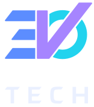

<p align="center">
  
</p>

# 3VOtech Brand

The 3VOtech logo, colors and brand guidelines, and the scripts that build the logo files.

| | |
|---|---|
| **[Brand guidelines](https://claude.ai/artifact/JYFjVYhhmqrUtjRxtgWYKG)** | What the logo means, which version to use, clear space, colors, and do's and don'ts. Start here. |
| **[Design system](https://claude.ai/artifact/RxtSDcDswrfJr3jqaBTRPA)** | Every logo and app icon file to download, the full Volt palette for the app, type, spacing and voice. |
| **[Logo studies](https://claude.ai/artifact/Vq7U2K9EhWdEGRpFEcChFA)** | How the logo got here: the first drafts, the concepts, the end caps and the fonts we tried. |

## The logo

The 3 in 3VOtech is a backward E, so the name reads EVO. The logo joins those three letters into one shape. The Ǝ's spine is also the V's stem. The V's long arm is a **check mark** that cuts through the O, because that is the job: check in, get the work done, check it off. The Ǝ's bars are cut at the same angle as the check, 54.6°, so they read as speed lines. Every version separates the letters the same way: a thin gap around the V where it meets the bars and crosses the O.

| Color, light ground | Color, dark ground | Black, for print | White |
|:---:|:---:|:---:|:---:|
|  |  |  |  |

Every logo comes in three arrangements: `horizontal` (wide spaces), `stacked` (the default) and `mark` (no room for TECH, the app icon). Each comes in five versions:

| Version | Use it on |
|---|---|
| `-color` | white and light grounds |
| `-color-dark` | navy grounds only; its lighter colors are made for navy |
| `-black` | paper, in one ink |
| `-white` | dark grounds, photos, shirts, hats, decals |
| `-navy` | one ink in brand navy, such as embroidery or signage |

The white files are white on a transparent ground, so they look empty on GitHub's light theme.

## Colors

| | Name | HEX | Dark mode | Role |
|---|---|---|---|---|
|  | Volt Blue | `#2459F5` | `#5C8DFF` | The Ǝ. In the app: anything you tap. |
|  | Ultraviolet | `#7A3CF0` | `#A685FF` | The V, the check. Brand moments only. |
|  | Spark Cyan | `#0891B2` | `#22D3EE` | The O. Anything live: scanning, syncing, checked in. |
|  | Navy Ink | `#0D1530` | | Text, TECH in the logo, a dark ground. |
|  | Midnight | `#0A1230` | | The dark background. Navy, never black. |
|  | Mist | `#F3F5FB` | | The light background. |

The app's full palette, with every role, the status colors and their contrast ratios, is in [`design-system/tokens.json`](design-system/tokens.json). Its source of truth is `src/theme` in [evolution-mobile](https://github.com/3votech/evolution-mobile).

## What's here

| Folder | What |
|---|---|
| `logos/` | The 15 logo SVGs. TECH is outlined artwork, so no font is needed to open them. |
| `app-icon/` | 1024px app icons (PNG and SVG, light and dark); the Ǝ, V and O as separate layers for Icon Composer, light and dark; Android's adaptive icon layers; and Evolution's splash screen, the mark over EVOLUTION. |
| `guidelines/` | The brand guidelines page: `template.html` is the source, `brand-guidelines.html` the built page. |
| `design-system/` | The design system's files: the brand book (`README.md`), `tokens.json`, its cover and asset notes. |
| `studies/` | The logo studies page, kept as the record of how the logo was made. |
| `docs/swatches/` | The color chips in this README. |
| `scripts/` | The build. |

## Building

Every file in `logos/`, `app-icon/` and `guidelines/brand-guidelines.html` is generated. Change the scripts or the template, never the output:

```sh
./scripts/build.sh
```

It needs [uv](https://docs.astral.sh/uv/) (for fontTools), curl and Google Chrome (to render the app icon PNGs). It downloads Saira from [google/fonts](https://github.com/google/fonts/tree/main/ofl/saira) into `fonts/`, which is not committed.

- `scripts/wordmarks.py` turns TECH, and EVOLUTION for the app, into Saira Expanded outlines (125% width, weight 600) and cuts every horizontal stroke end at 54.6°.
- `scripts/logos.py` draws the mark and assembles every logo and app icon. The geometry lives here: the bars, the V and the O, in a 100-unit-tall mark.
- `scripts/guidelines.py` builds the guidelines page with the logos inlined.

After a rebuild, `git status` shows exactly which files changed. Upload changed logos to the design system, and republish the guidelines page, so the links above stay current.
